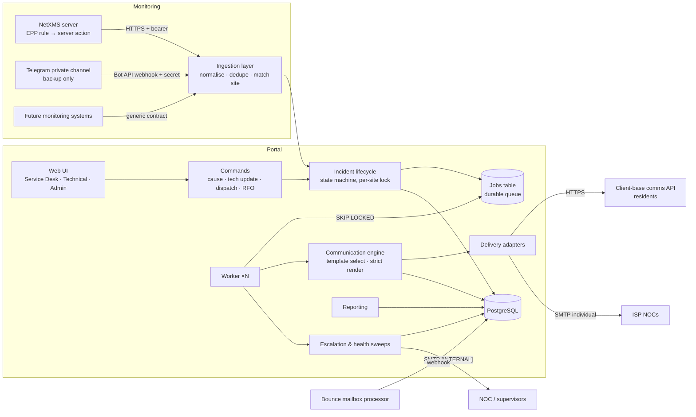
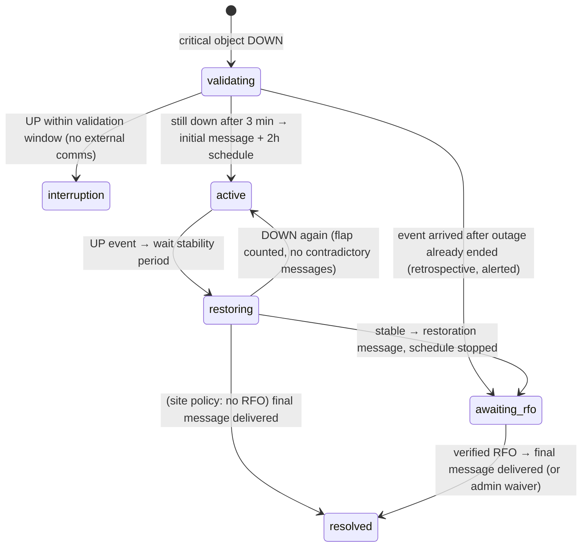

# Architecture

## 1. What the platform does

```
NetXMS detects outage → portal validates 3 min → approved initial message auto-sent
→ Service Desk confirms cause (1 click) → Technical pastes provider updates (facts verified)
→ approved updates sent immediately + every 2 h without anyone → link restored & stable
→ approved restoration notice → verified RFO entered → final message → resolved → reports
```

People only do four things: **confirm a cause**, **enter verified technical updates / RFO**, **log or confirm an urgent dispatch**, **approve wording and policy**. Everything else is server-side automation.

## 2. Technology stack — and why

| Layer | Choice | Reason |
|---|---|---|
| Language | TypeScript (strict) | One language end to end; same stack as the ATEC Training Portal so the same people can maintain it. |
| Web/UI | Next.js 14 App Router + React 18 + Tailwind (ATEC tokens) | Server-rendered auth gates, route handlers for the API, one deployable. |
| Database | PostgreSQL 16 | Source of truth for incidents, schedules, communications, audit. Partial unique indexes and advisory locks give correctness guarantees cheaply. |
| ORM / migrations | Drizzle + SQL migrations | Typed queries, plain SQL migrations reviewed in git. |
| Job queue | **Postgres table + `FOR UPDATE SKIP LOCKED`** (not Redis) | Jobs commit atomically with the state change that created them. No "email scheduled for an incident that rolled back"; nothing lost if Redis restarts; one less system to run. Throughput needed is tiny (tens of jobs/min). |
| Real-time | Server-Sent Events change feed | Works through proxies, no extra infra; clients refetch on change. |
| Email | SMTP (nodemailer) for ISPs + internal; HTTPS adapter for the client-base API | As specified by ATEC. Individual sends only. |
| AI (optional) | Anthropic API, forced tool-call schema, verbatim-evidence check | Cross-checks deterministic extraction; never writes customer text. Portal is fully functional without it. |
| Deploy | Docker Compose (db, migrate, web, worker×2, optional Caddy TLS, bounces, backup) | Self-hosted as requested. |

## 3. Components



Separation required by the brief, and where it lives:

| Concern | Code |
|---|---|
| Monitoring event ingestion | `src/server/ingestion/*`, `src/app/api/ingest/*` |
| Incident lifecycle | `src/server/incidents/lifecycle.ts`, `transitions.ts`, `actions.ts` |
| Scheduling & automation | `src/server/scheduler/*`, `src/worker/main.ts`, `src/server/escalations/engine.ts` |
| Template rendering | `src/server/comms/render.ts`, `templates.ts` |
| Communication delivery | `src/server/comms/engine.ts`, `adapters/*`, `delivery-status.ts` |
| Reporting | `src/server/reports/*` |
| UI | `src/app/*`, `src/components/*` |

## 4. Incident state machine



`phase` drives automation. `status` (validating, awaiting cause, power outage — area, technician required, technician investigating, awaiting backhaul update, restoring, restored — awaiting RFO, resolved, short interruption) is **derived** from phase + verified facts and shown to people. Illegal transitions throw.

Correctness guarantees enforced by the database:

* **One open incident per site** — partial unique index `incidents_one_open_per_site`.
* **Event idempotency** — `monitoring_events.dedupe_key` unique.
* **Message idempotency** — `communications.idempotency_key` unique; one delivery per (message, channel, address).
* **One pending job per dedupe key** — partial unique index on `jobs`.
* **Per-site serialisation** — `pg_advisory_xact_lock(hashtext('site:'||id))` around every event and timer for that site.
* **Optimistic concurrency for people** — `incidents.version` checked on every command (edge case 25).
* **Append-only audit** (trigger) with SHA-256 hash chain; **immutable technical notes** (trigger); **frozen approved wording** (trigger).

## 5. Communication engine

1. A lifecycle step requests a *kind* (`initial_outage`, `power_area`, `eta_changed`, …) and a *purpose*.
2. Template selection walks a deterministic **fallback chain** (e.g. `eta_changed → eta_available → eta_unavailable → no_update → initial_outage`) and uses the first **published** template that renders using **verified data only**. A template that needs `{{eta}}` cannot render without a verified ETA, so it falls back — the system can never invent an ETA.
3. Optional facts are handled inside approved wording with `{{#eta}}…{{/eta}}` / `{{^eta}}…{{/eta}}` sections, so one approved template covers "with ETA" and "without ETA" without any text being generated.
4. The rendered text is **frozen** on the communication row (a later template edit never changes a queued message — edge case 20).
5. Recipients are planned per audience: residents → the site's client-API distribution list; ISPs → each active contact of each ISP linked to the site, individually. Suppressed/invalid contacts are recorded as suppressed, not silently dropped.
6. A durable `deliver_communication` job sends outside any DB transaction, records each attempt, retries transient failures (1, 3, 10, 30, 60 min — configurable), fails permanent errors, raises alerts, and reconciles the message status.
7. **Contradiction guard:** an outage update that nobody has received yet is cancelled if the link is confirmed restored before it goes out (edge case 18). Cause corrections cancel the superseded unsent cause message (edge case 9).
8. **Two-hour cycle:** each incident has its own `communication_schedules` row and its own job. Every outage message (initial, cause, technical, periodic) restarts the clock from that message (configurable for technical updates). The periodic job checks the schedule row's `next_due_at` matches its own payload, so stale or duplicate timers are harmless.

"Accepted" is never reported as "delivered": SMTP only reaches *accepted*; delivered/bounced arrive via the bounce processor or the client API callback.

## 6. Technical update processing (AI safeguards)

```
pasted text ──► deterministic rules (lexicon, negation, time parsing)  ──► facts + evidence + confidence + conflicts
            └─► optional AI (forced schema, enums only, must quote verbatim evidence) ─► agree ↑ / disagree → conflict
                                     ▼
          Technician reviews pre-filled fields (low-confidence & conflicting fields NOT pre-filled)
                                     ▼
          Server re-validates (zod, enums, ETA not in past, conflict acknowledgement required)
                                     ▼
          Diff vs verified state → customer-relevant change? → approved template → send now
```

* "Technicians are investigating" maps to `repairStatus=investigating`, which is **internal only** — it is not "repairs underway".
* Customer wording for faults/providers/causes comes from **admin-controlled vocabularies** (`fault_types.public_description`, `backhaul_providers.public_name`, `cause_options.public_description`) — pasted supplier text never reaches a customer. The only free text that does is the **verified RFO**, which Technical writes for customers and explicitly confirms.
* Pasted text is data: it is never templated (`{{…}}` inside values is inert), never executed, and the AI has no tools besides returning facts.
* If the AI is unavailable or slow, the rules result is used — the portal never depends on AI.

## 7. Database schema (core)

`sites`, `site_monitoring_identifiers`, `monitored_object_state`, `backhaul_providers`, `isps`, `site_isps`, `recipients`, `incidents`, `incident_groups`, `correlation_suggestions`, `monitoring_events`, `incident_transitions`, `timeline_entries`, `cause_options`, `cause_confirmations`, `fault_types`, `technical_updates`, `technician_dispatches`, `rfo_records`, `communication_templates`, `template_versions`, `template_approvals`, `communication_schedules`, `communications`, `communication_deliveries`, `delivery_events`, `escalation_rules`, `escalations`, `jobs`, `integration_health`, `system_alerts`, `settings`, `users`, `roles`, `sessions`, `audit_logs`.

Full definitions: `src/server/db/schema.ts`; migrations in `drizzle/`. All times are `timestamptz` stored in UTC and displayed in Africa/Johannesburg.

## 8. Security architecture

* Opaque session tokens (only SHA-256 stored), httpOnly + SameSite=Lax cookies, idle and absolute expiry, lockout after 5 failed logins, timing-equalised unknown-user path.
* TOTP MFA, **enforced for administrators** (configurable for all); secrets AES-256-GCM encrypted at rest (`APP_ENCRYPTION_KEY`).
* Server-side RBAC on every route (`src/server/auth/permissions.ts`); UI hides what a role cannot do but never relies on that.
* Same-origin check on every state-changing request (CSRF), strict security headers, no framing.
* Machine endpoints: bearer tokens (timing-safe compare) + optional IP allow-list (NetXMS), Telegram secret-token header + chat allow-list, HMAC-SHA256 for the client-API callback.
* Input validation with zod everywhere; parameterised SQL only; CSV export neutralises formula injection.
* Four-eyes template approval; published wording immutable; audit log append-only and hash-chained (verified in Admin › System health).
* POPIA: minimal personal data (ISP business contacts, staff accounts; residents are addressed through the client system's list reference, not stored here), retention job clears raw payloads, expired sessions and finished jobs; contact changes are audited.

## 9. Failure recovery

| Failure | Behaviour |
|---|---|
| Worker crashes mid-job | Lease expires (5 min) → another worker re-runs; handlers are idempotent. Run ≥2 workers. |
| App/DB restart | All state and timers are rows; overdue jobs run immediately on start (catch-up). |
| Email/API provider down | Deliveries deferred and retried with backoff; alerts raised; incident shows "retrying"; permanent failure escalated. |
| NetXMS silent | Health sweep alerts after `monitoringSilenceAlertMinutes` (use the heartbeat). |
| Events late / out of order | Per-object state ordered by source timestamp; late DOWN before a known UP is reconstructed as an interruption or retrospective outage (no contradictory messages). |
| Stalled scheduler | Header banner + `/api/health` 503 + "communication overdue" escalation + queue-backlog alert. |
| Job keeps failing | Dead-letter after N attempts, critical alert, one-click retry in Admin. |
| AI unavailable | Rules-only extraction; noted in the UI. |

## 10. Risks identified in the requested workflow (and how they are handled)

1. **Reading another bot's Telegram messages is not possible** — Telegram bots cannot see messages from other bots in groups. → Primary integration is NetXMS → portal directly. Telegram is an optional backup via a private *channel* where the portal's bot is admin.
2. **3-minute rule vs. delayed events** — if NetXMS events arrive late, a long outage may only be learnt about after it ended. → Recorded as retrospective, alerted, no misleading messages.
3. **NetXMS "unreachable" vs "down"** — with topology polling, nodes behind a failed uplink raise `SYS_NODE_UNREACHABLE`. → Treated as down by default (configurable).
4. **Interface flaps on a healthy node** — only registered interface identifiers count; node-name matches ignore interface events.
5. **Repeating a stale ETA every 2 h** — an ETA in the past is never quoted; Technical is escalated to obtain a new one.
6. **Cause correction after a message went out** — the system never recalls delivered mail; it cancels anything unsent and the next message uses the corrected cause. Administrators may want an explicit "correction" template — add a custom kind if required.
7. **Admin-edited vocabularies are customer-facing** — fault/provider/cause wording is inserted verbatim; the UI flags these fields and every change is audited. If stricter control is wanted, route them through template approval (future change).
8. **SMTP gives no delivery receipts** — bounces only arrive asynchronously; configure the bounce mailbox processor or ISP delivery is "accepted" only.
9. **Duplicate SMTP on crash** — at-least-once delivery; a deterministic Message-ID per delivery lets receiving systems de-duplicate. A missed outage notice is the worse failure.
10. **Single administrator** — four-eyes approval needs two admins; `TEMPLATE_SELF_APPROVAL=true` exists for small teams but weakens control.
